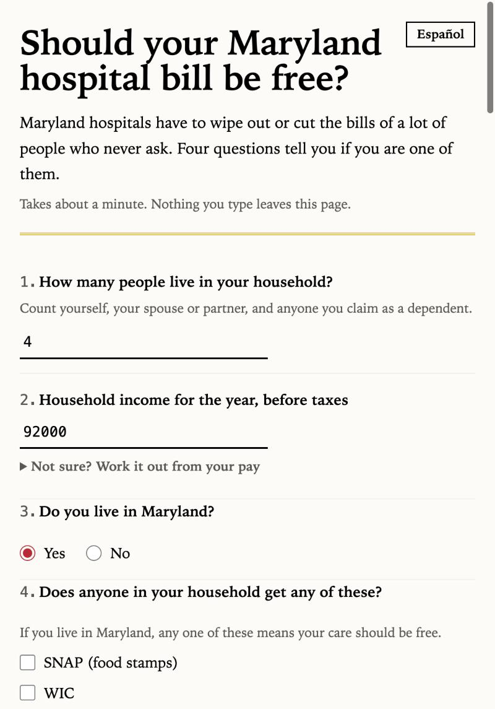
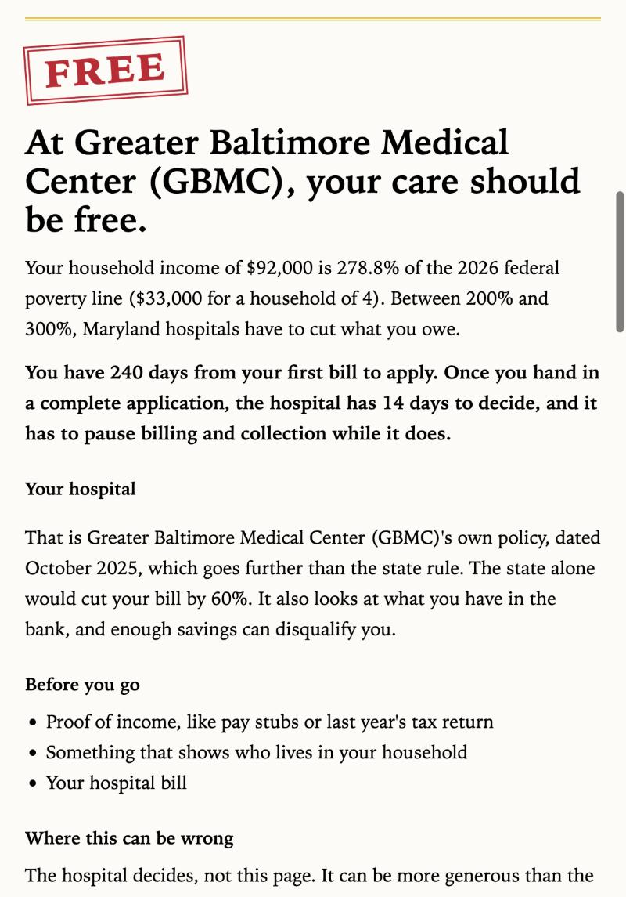
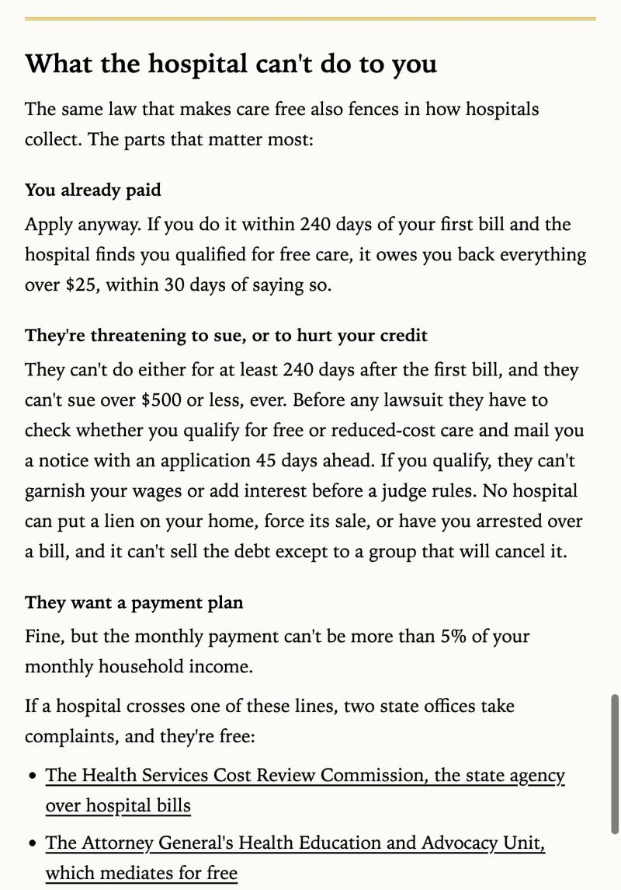

# freecare

Should your Maryland hospital bill be free? A one-page checker that answers in about a minute, using Maryland's own rules and your hospital's own policy, then fills the state application on your phone. It runs entirely in your browser: nothing you type is sent anywhere.

Live: https://akadigari.github.io/freecare/

<p align="center">
  
  
  
</p>

## Why

Maryland law makes hospitals write off bills for people at or below 200% of the poverty line and cut them up to 300%, and most of the people it covers never apply. Every hospital uses the same state form, and most hospital policies go past the state minimum. The gap is not the law, it is that nobody tells you, and the form is a chore. This page does both parts: it tells you, and it fills the form.

## By the numbers

| | |
|---|---|
| Tests | 125, run with Node's own test runner |
| npm dependencies | 0 |
| Outside requests from the page | 0, and a test proves it |
| Hospital policies read and encoded | 19 of 19 on the state's list |
| Fields filled on the state PDF | 43 |
| Languages | English and Spanish, every word |
| Files kept for offline use | 27 |

## What it does today

- Tells you whether state law says your care should be free, 75% off, 60% off, or a hardship discount, and that the hospital makes the final decision
- Shows your household income as a percent of the federal poverty line
- Works out the yearly figure from hourly, weekly, every-two-weeks or monthly pay, for people who only know what their paycheck says
- Counts the days you have left to apply (240 from the first bill)
- Lists what to bring, and which law the answer comes from
- Works in English and Spanish. A switch at the top of the page changes every word, including the results and the error messages. The choice is remembered in your browser only.
- Lets you pick your hospital (19 Maryland hospitals and health systems, from the state's own list) and links to that hospital's policy on the state's site, with a plain line on where to send the form.
- Tells you what happens after you apply: the hospital has 14 days to decide on a complete application and must pause billing and collection while it does (Health-General 19-214.1).
- Prints a one-page cover letter to go with the application. It cites the law, states your household size, income and percent of the poverty line, the date of your first bill and the 240-day window, and asks the hospital for its decision in writing within the 14 days. Lines you left blank are left out, not printed as blanks. English or Spanish, following the page.
- Shares the result from your phone's own share sheet (or copies it, on a computer): the answer, the math, the deadline and the law in a few lines. Still no network requests; the text goes only where you send it.
- Checks your hospital's own policy against the state rule and shows whichever gives more. Where a policy adds a catch, like an asset test, the result says so in a sentence. All 19 policies were read from the state's copies on October 28, 2026 (four are scanned images and were read with OCR, then checked by eye). Four hospitals go well past the state: ChristianaCare Union gives free care up to 400% of the poverty line, GBMC and LifeBridge up to 300%, and Johns Hopkins and MedStar cut bills without a hardship up to 400%. When the hospital gives more, the headline and the stamp say so, with the policy's date. One policy (Adventist) promises help without saying how much, and the state's copy for UPMC Western Maryland has no income rules; the page says so instead of guessing. Frederick Health's state copy left the bands blank, so its bands were read from the hospital's own 2026 matrix on November 2, 2026: the state minimum exactly, plus 20% off above 500% of the poverty line.
- Reads a photo of the bill, on your phone. Text recognition (tesseract.js, vendored, about 6 MB that loads only when you pick a photo) runs in the browser and finds the hospital, the bill date and the amount due. Each one shows with a "Use this" button; nothing fills in until you confirm it, and the photo is never uploaded. It works well on a flat, well-lit photo of a printed bill and poorly on a crumpled or dark one.
- Prints the result on one clean page for the billing desk, and saves the deadline as a calendar reminder (a standard .ics file made on the device, with a warning a week before).
- Asks the Medicaid and assets questions, so the application comes out complete.
- Says what a hospital cannot do to collect, in three situations (you already paid, they threaten to sue or hurt your credit, they want a payment plan), from the collection statute as read on October 28, 2026, with links to the two state offices that take complaints. No phone numbers on purpose.
- Opens with no signal once it has been opened once, and can be added to a phone's home screen. A service worker keeps a copy of the page on the device and refreshes it quietly on each visit, so a change shows up on the second load. The 13 MB bill reader is saved the first time it is used, not up front.
- Fills in Maryland's statewide financial assistance application for you. Every Maryland hospital uses the same form (revised March 6, 2026). You add your name, address, phone and household members; the page puts those and your income, residency and hardship answers into the state's own PDF and downloads it. The signature line stays blank for you to sign. The PDF is built on your device with pdf-lib; the page fetches only its own copy of the form.

## The rules

Poverty line (HHS, 2026, 48 states and DC, published Jan 15, 2026): $15,960 for 1 person plus $5,680 for each extra person.

| Situation | Result |
|---|---|
| On SNAP, WIC, or Maryland Energy Assistance, or a child gets free or reduced-price school meals | Free |
| Income at or below 200% of the poverty line | Free |
| Over 200%, up to 250% | 75% off |
| Over 250%, up to 300% | 60% off |
| Over 300%, up to 500%, and medical bills in the last 12 months are more than 25% of income | 50%, 45%, 40% or 35% off |
| Over 300% without that hardship, or over 500% | Not required by state law. Ask the hospital anyway |
| Not a Maryland resident | Not covered by the state rule. Check the hospital's own policy |

Sources: [Maryland Health-General 19-214.1](https://mgaleg.maryland.gov/mgawebsite/Laws/StatuteText?article=ghg&enactments=false&section=19-214.1), [19-214.2](https://mgaleg.maryland.gov/mgawebsite/Laws/StatuteText?article=ghg&section=19-214.2&enactments=false) for what a hospital cannot do to collect, [COMAR 10.37.13.06](https://regs.maryland.gov/us/md/exec/comar/10.37.13.06), [HHS poverty guidelines](https://aspe.hhs.gov/topics/poverty-economic-mobility/poverty-guidelines). Checked September 2026. This is a guide, not legal advice. Hospitals can be more generous, and some also look at savings.

## Run it

```
npm test                      # 125 tests, Node 22, no dependencies to install
python3 -m http.server 8780   # then open http://localhost:8780
```

## How it is built

| File | Job |
|---|---|
| `src/poverty.js` | The 2026 poverty line. Update every January |
| `src/dates.js` | Date-only math that never shifts across time zones |
| `src/rules.js` | Maryland's tiers, hardship, programs and the 240-day window |
| `src/form.js` | Turns what people type ("$60,000") into clean input |
| `src/present.js` | Plain-English results |
| `src/check.js` | Runs a check from form fields to result, and turns any unexpected error into a clear message |
| `src/apply.js` | Maps the answers onto the state form's fields and fills the PDF. The yes or no questions are radio groups; the left box is Yes |
| `src/strings.js`, `src/i18n.js` | Every word on the page in English and Spanish, and the switch between them. The tests check that the English on the page matches the English in the strings file |
| `src/hospitals.js` | The 19 hospitals and health systems with each one's policy link, read from HSCRC's Financial Assistance Policies page on 2026-10-28. No phone numbers on purpose |
| `forms/` | The blank state form, downloaded from a Maryland hospital's copy of the HSCRC form, revised 2026-03-06 |
| `src/bill.js` | Reads the recognized text of a bill: the hospital (by everyday name), the bill date (statement date wins, due date never), the amount due |
| `src/ocr.js` | Runs the on-device text recognizer against a photo, with the vendored worker, core and English model |
| `src/calendar.js` | The deadline reminder as a calendar file |
| `src/income.js` | Pay per hour, week, two weeks or month, turned into a yearly figure |
| `src/policies.js` | What each hospital's own policy gives (free-care limit, discount bands, hardship bands, policy date), read on 2026-10-28, and the comparison with the state rule. A policy can only add to the state floor |
| `src/rights.js` | The collection rules, with the statute and the two state help links. The wording lives in `src/strings.js`, each sentence with the subsection it rests on |
| `sw.js`, `manifest.json`, `icons/` | The saved copy of the page for offline use, and what a phone needs to add it to the home screen. A test checks that every file the worker saves exists |
| `.github/workflows/test.yml` | Runs the tests on every push |
| `vendor/pdf-lib/` | pdf-lib 1.17.1 (MIT), used to fill the form in the browser. Loads only when someone fills the application |
| `vendor/tesseract/` | tesseract.js 7.0.0 and tesseract.js-core 7.0.0 (Apache-2.0), LSTM builds only, plus the fast English model from tessdata. Loads only when someone picks a photo |
| `src/app.js`, `index.html`, `src/styles.css` | The page, set like a printed statement. System fonts, no outside requests |

## Engineering notes

- **No framework, no build step, no dependencies.** The browser runs the ES modules as written and Node's test runner runs the same files. A tool for someone on an old phone in a hospital basement needs to be small and boring, and a dependency that changes under you is neither.
- **Nothing leaves the device, and a test says so.** The suite greps the page and the script for any outside URL. The PDF is filled with a vendored copy of pdf-lib. Text recognition is a vendored tesseract.js that loads only when a photo is picked. The service worker answers only for its own origin.
- **The law is code with its source next to it.** `rules.js` carries the statute sections. `poverty.js` carries the year and a test pins the table. `policies.js` carries each hospital's policy date. Each sentence in the rights block carries the subsection it rests on, in a comment.
- **The English on the page is the English in the strings file.** A test diffs them, so a Spanish translation can never sit under a stale English line.
- **Recognized text never fills a field by itself.** Every finding from the bill reader shows with a "Use this" button. A wrong hospital or a wrong date does harm, so the person confirms each one.
- **The page is the bill, corrected.** The first screen is a statement block: the amount due struck through, and under it what the law says you owe, in dollars once the person types their bill amount. It is set in one plain grotesque on white, the way a printed statement is, because that is the object a patient is holding.
- **Small things that would have been bugs.** The yes or no questions on the state PDF are radio groups where the left box is Yes, found by dumping widget positions and pinned by a test. Date math is date-only, in UTC, with a test that crosses a daylight-saving change. The percent of the poverty line rounds up, so an income just over a cutoff never reads as "at" it.
- **Reading 19 policies.** Fifteen are text. Four are scanned images; those were read with a 30-line Swift script on Apple's built-in text recognition, then checked by eye against the pages. The script is not in this repo.

## Tests

```
npm test
```

Unit tests cover the rules at every boundary (200, 200.01, 250, 300, 500 percent and so on), the form parser, the dates, the poverty table, the PDF field map (a round trip through the real state form), the bill reader's heuristics, the calendar file, the pay helper, the rights text in both languages, the hospital policies, the offline file list, and the page itself (markup, i18n parity, contrast, no outside requests). There is no end-to-end runner; the flows were checked by hand in a browser before each commit.

## Not in this version

Other states and hospital phone numbers. The photo reader handles English bills only. The filled form is the English state form even when the page is in Spanish; hospitals accept it either way.

## Author

Ayush Kadigari, a senior at the University of Maryland studying information science and economics. Email: arkadigari@gmail.com. Built with Claude Code as a pair programmer. MIT license.
